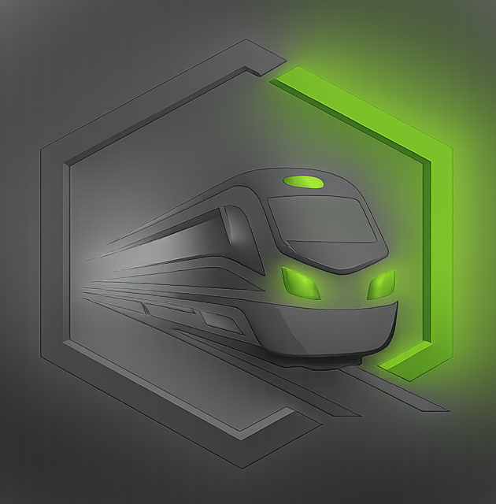
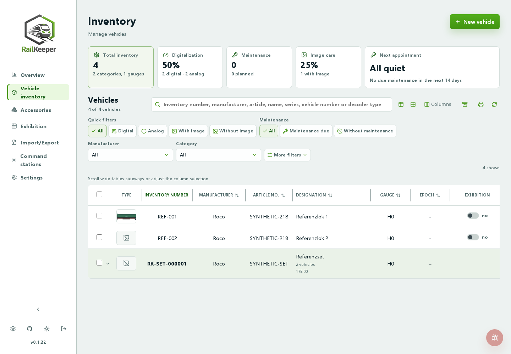
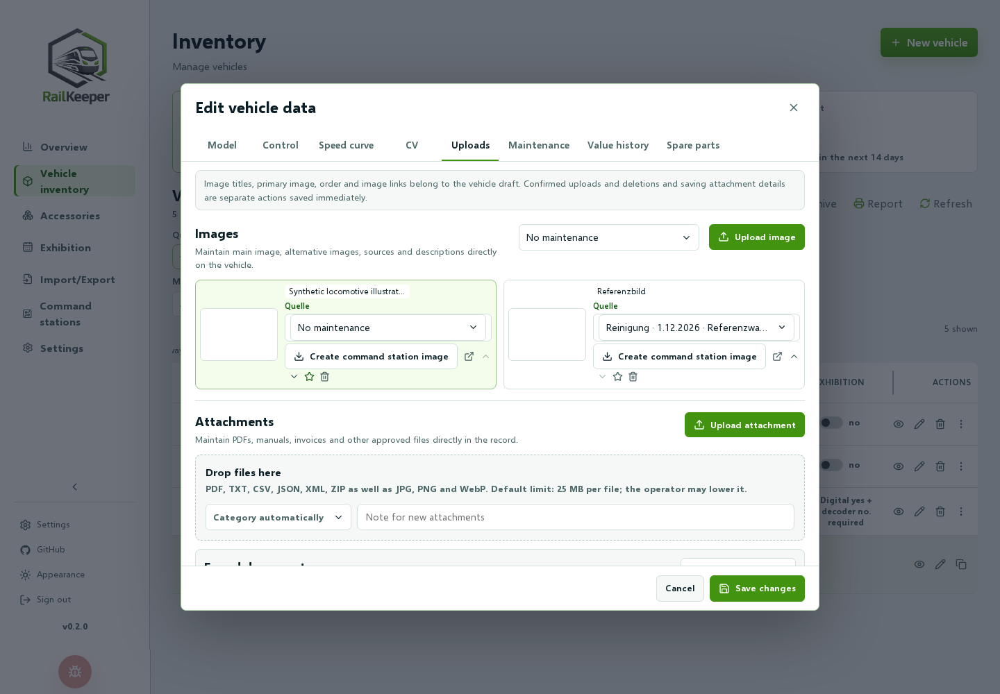
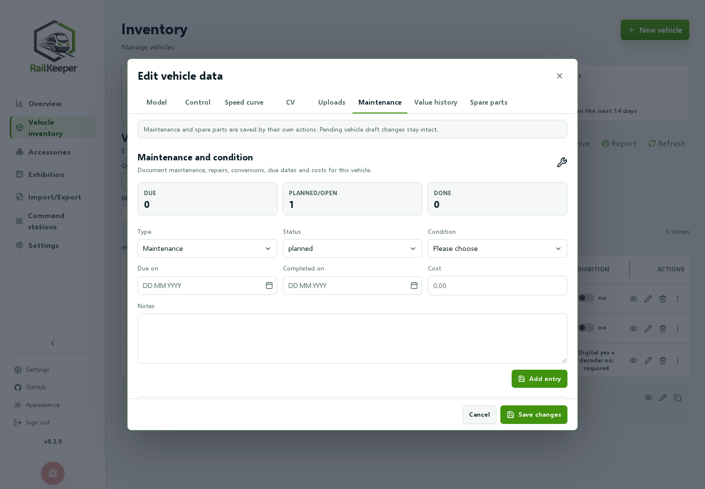

<p align="center">
  
</p>

<h1 align="center">RailKeeper</h1>

<p align="center">
  Your model railway collection in one place. Locally on your computer or home server.
</p>

<p align="center">
  <a href="https://github.com/ichwars/RailKeeper/releases/latest"></a>
  <a href="https://github.com/ichwars/RailKeeper/actions/workflows/ci.yml"></a>
  
  <a href="LICENSE.md"></a>
  <a href="https://github.com/ichwars/RailKeeper/releases"></a>
</p>

<p align="center">
  <strong>English</strong> · <a href="README.de.md">Deutsch</a> ·
  <a href="https://ichwars.github.io/RailKeeper/">Documentation</a>
</p>

<p align="center">
  <a href="https://github.com/ichwars/RailKeeper/releases/latest">Download for Windows</a> ·
  <a href="https://ichwars.github.io/RailKeeper/try#docker">Start with Docker</a> ·
  <a href="https://ichwars.github.io/RailKeeper/try#sample-data">Try with sample data</a>
</p>

## Overview

RailKeeper brings your model railway collection together: vehicles, pictures, documents,
maintenance and decoder data in one place. Start with a single locomotive or import existing
tables with a preview. You do not need a command station to manage your collection.

- **Find your stock:** Search locomotives, coaches and sets and look up their details.
- **Documents with their vehicle:** Keep pictures, manuals and attachments with the right model.
- **Keep track of maintenance:** Document cleaning, repairs and modifications and their history.

The [tester quick start](https://ichwars.github.io/RailKeeper/try) takes you from startup to sample
vehicles and a vehicle of your own with a picture. The
[illustrated handbook](https://ichwars.github.io/RailKeeper/guide/) helps with the next tasks.
RailKeeper is free and open source and runs on Windows or with Docker on your home server.

## Screens

| Vehicle inventory | Pictures and documents | Maintenance |
| --- | --- | --- |
|  |  |  |

These pictures show a separate demo installation with synthetic data and the documented development
version. See the [release notes](https://github.com/ichwars/RailKeeper/releases/latest) for the
published download's scope. The [coverage overview](https://ichwars.github.io/RailKeeper/reference/coverage)
records review evidence and known limits.

Share your experience in [Discussions](https://github.com/ichwars/RailKeeper/discussions/categories/general).
Does RailKeeper help you? Support the project with a [star on GitHub](https://github.com/ichwars/RailKeeper).

## Highlights

- Responsive operations dashboard with inventory, value, maintenance, data-quality and command-station status in one view
- Profile-based import and export for vehicles, accessories and exhibition lists, including previews,
  conflict resolution, persistent jobs, transfer history and local artifacts. Master data remains
  exclusively under Settings.
- Dedicated command-station workspace with configured stations, locomotive comparison, live status,
  diagnostics and preview-before-write synchronization
- Persistent exhibition operations with events, participants, multi-day vehicle assignments,
  readiness checks, conflict handling, images, function keys, printing and list locking
- Local-first inventory with SQLite, uploads and JSON backups
- Vehicle records with model data, technical fields, ownership details, images, attachments, QR codes and clean read-only detail views
- Article inventory with generated inventory numbers, sortable selection-first overview, quantity or individual tracking, storage-location stock, reservations, installations, documents and usage history
- Article data web search with configurable sources, barcode/EAN entry, ZXing-based camera scanning,
  typed track details, and explicit field-by-field review
- PDF report dialog for inventory overview and detail lists with selectable vehicles, QR codes and images
- Responsive inventory workflow with mobile-optimized dialogs, filter controls and camera fallback for barcode entry
- Reviewed ECoS locomotive exchange reads locomotive data, CV values, and static function keys, then
  writes name, address, and protocol only after preview and confirmation. It does not monitor speed,
  direction, active function states, or ECoS layout object managers. CS3 reads name, address, and
  protocol into the comparison workspace without writing. Z21 and Intellibox 3 remain connection
  and diagnostic adapters.
- Decoder function mapping from F0 to F31 with symbol library and stored SVG/PNG graphics
- Structured CV values, CV import/export, decoder profiles, NMRA CV8 manufacturer master data and ESU/LokProgrammer file metadata
- Maintenance, condition history and searchable documentation per vehicle
- Local authentication with first-run setup including email, roles, sessions, password change, token-based password reset and audit log
- User-specific sidebar order and visibility for tailoring the main navigation per login
- Master data management for manufacturers, gauges, epochs, categories, subtypes, railway companies and symbols
- Docker Compose deployment with hardened runtime container and persistent `/data` volume
- Built-in GitHub release update check with release notes and user-controlled installation flow

## Quick Start

### Windows Standalone (no installation required)

Download the Windows x64 ZIP from a release, extract it completely and start:

```text
start-railkeeper.bat
```

RailKeeper runs locally without additional software. By default, persistent data is stored outside
the replaceable program folder at `%LOCALAPPDATA%\RailKeeper\data`. The ZIP deliberately contains
no database, uploads, backups, or `data` directory. Replacing the extracted program folder therefore
does not replace the active user data.

On the first start after an older Portable or Standalone version, RailKeeper copies a legacy `data`
folder beside `RailKeeper.exe` into the safe location and retains the source unchanged. If both
locations contain different databases, startup stops on a local safety page and changes neither
copy. The active absolute path and the retained migration source are visible to administrators under
Settings. Set `RAILKEEPER_DATA_DIR` only when an explicit alternative is required. A path inside the
program folder or on removable media can still be lost when that location is deleted or replaced.
External backups remain necessary.

When Windows Standalone detects a newer release under **Settings > General > Updates**, the button
names the available version and starts the matching GitHub ZIP download. RailKeeper does not extract,
install, replace, or restart anything. Create a backup, close RailKeeper, extract the downloaded ZIP
into a new program folder, and verify the displayed data path and inventory after starting it. If no
trusted matching ZIP is available, use the linked GitHub release page instead.

### Docker Compose

Docker builds support `linux/amd64` and `linux/arm64`. Raspberry Pi installations need a
64-bit ARM operating system; 32-bit ARM images are not provided. Docker selects the matching
architecture automatically, so remove any `platform: linux/amd64` override on ARM64.
Starting with v0.1.22, stable images (`latest` and versioned release tags) include ARM64.
Older release tags are not rebuilt automatically. `edge` follows development on `main`.

```bash
git clone https://github.com/ichwars/RailKeeper.git
cd RailKeeper
docker compose pull
docker compose up -d
```

Open:

```text
http://localhost:8080
```

On first start RailKeeper opens the setup screen. Create the first admin account there. No default credentials are shipped.

### Update an existing Docker installation

```bash
git pull
docker compose pull
docker compose up -d
```

The SQLite database, uploads and local files stay in the `railkeeper_data` Docker volume.

To pin a specific release instead of `latest`, set this in `.env`:

```env
RAILKEEPER_IMAGE=ghcr.io/ichwars/railkeeper:v0.1.22
```

If you intentionally want to build the checked-out source tree, use:

```bash
docker compose up -d --build
```

### Optional environment file

Copy `.env.example` to `.env` only when you want to override operational settings such as secure cookies, upload limits, printer configuration or the GitHub release endpoint.

Do not override these container paths in Docker Compose:

```env
RAILKEEPER_DATA_DIR=/data
RAILKEEPER_MIGRATIONS_DIR=/app/migrations
RAILKEEPER_SEEDS_DIR=/app/seeds
RAILKEEPER_STATIC_DIR=/app/web
```

### Optional in-app bug reporting

Operators can enable the floating **Report issue** form so authenticated users can create a labeled
GitHub issue directly from RailKeeper. It requires an issue token/repository. Separate asset credentials for a different public repository
optionally enable screenshots. If startup validation fails or the
feature is not configured, the button remains an external GitHub Issues link.

Users can disable automatic diagnostics; the choice is remembered in their browser.
When enabled, the report contains bounded runtime, browser, presentation, navigation, role, enabled
digital-provider-type, and sanitized client-error diagnostics. It does not collect inventory data
or counts, connected-device statistics or connection details, credentials, request contents, or
local paths. Screenshots are optional, sanitized, and public only after explicit consent.

See the [bug-reporting guide](docs/site/guide/settings/bug-reporting.md) and the
[deployment notes](deploy/README.md#in-app-bug-reporting) for the full setup and privacy contract.

## Local Development

Backend:

```bash
cd backend
go test ./...
go run ./cmd/railkeeper
```

Frontend:

```bash
cd frontend
npm ci
npm run build
```

The production runtime serves the built frontend from `frontend/dist`.

`npm ci` also installs the isolated, pinned OpenAPI type generator. The frontend development,
test, typecheck and build scripts generate ignored transport types from `openapi/railkeeper.yaml`
automatically. Generated types do not need to be committed or prepared by hand.

Create a Windows Standalone package:

```powershell
.\tools\build_windows_standalone.ps1
```

The script builds the frontend, cross-compiles `RailKeeper.exe` for Windows x64, rejects any user-data
content in the staged tree and ZIP, and creates
`dist\windows-standalone\RailKeeper-windows-x64-v<version>.zip`.

Useful local defaults:

```env
RAILKEEPER_ADDR=:8080
RAILKEEPER_DATA_DIR=./data
RAILKEEPER_MIGRATIONS_DIR=./backend/migrations
RAILKEEPER_SEEDS_DIR=./backend/seeds
RAILKEEPER_STATIC_DIR=./frontend/dist
RAILKEEPER_COOKIE_SECURE=false
RAILKEEPER_UPDATE_CHECK_URL=https://api.github.com/repos/ichwars/RailKeeper/releases/latest
RAILKEEPER_TRUSTED_PROXY_CIDRS=
```

Optional SMTP settings for password reset emails can be configured in the Admin UI under
`Einstellungen > Authentifizierung > SMTP für Passwort-Reset`. The environment variables
below remain useful as deployment defaults:

```env
RAILKEEPER_PUBLIC_URL=https://railkeeper.example.test
RAILKEEPER_SMTP_HOST=smtp.example.test
RAILKEEPER_SMTP_PORT=587
RAILKEEPER_SMTP_USER=railkeeper@example.test
RAILKEEPER_SMTP_PASSWORD=change-me
RAILKEEPER_SMTP_FROM=railkeeper@example.test
RAILKEEPER_SMTP_TLS=starttls
```

Password-reset emails are sent only when `RAILKEEPER_PUBLIC_URL` or the public URL stored in the
Admin UI is a valid HTTP(S) origin. RailKeeper never derives emailed reset links from the request
`Host` header.

If SMTP is not configured, password reset links are neither returned to the browser nor written to
the server log. An administrator must configure SMTP before the reset flow can deliver a link.

### Optional OCR for scanned spare-parts PDFs

RailKeeper reads text-based PDF spare-parts lists directly. For scanned PDFs without a text layer,
install either `ocrmypdf` or both `pdftoppm` and `tesseract` on the host and keep the tools available
in `PATH`. The OCR fallback is used only when the built-in PDF text extraction does not find usable
spare-parts text.

```env
RAILKEEPER_PDF_OCR=on
RAILKEEPER_PDF_OCR_MAX_PAGES=4
```

Set `RAILKEEPER_PDF_OCR=off` to disable the fallback explicitly.

## Architecture

```text
backend/
  cmd/railkeeper/          Go entrypoint
  internal/api/            HTTP routes, middleware and response mapping
  internal/application/    use cases, validation, backup and transactions
  internal/infrastructure/ SQLite, migrations and seed loading
  migrations/              SQLite schema migrations
  seeds/                   master data seed JSON
frontend/
  src/app/                 shell, routing and global styles
  src/features/            setup, auth, vehicles, exhibition, import/export, digital centers, settings
  src/shared/              API adapter, i18n and shared frontend types
openapi/
  railkeeper.yaml          API contract
deploy/
  README.md                deployment notes
docs/
  architecture.md
  production-runbook.md
  roadmap.md
  security.md
```

## Security

RailKeeper is intended for trusted self-hosted environments, but the default installation avoids the common mistakes:

- no default admin account
- Argon2id password hashing
- HTTP-only session cookies
- SameSite cookies and CSRF protection
- role checks for viewer, editor, admin and Messe workflows
- setup, login and session rate limiting
- password reset links are sent by email when SMTP is configured
- audit log for relevant security and data actions
- upload size limits and executable attachment blocking
- image dimension limits of 12,000 pixels per side and 40 megapixels before decoding
- runtime data ignored by Git

For HTTPS deployments set:

```env
RAILKEEPER_COOKIE_SECURE=true
```

## Counters And Badges

The README includes a GitHub release download badge. GitHub does not provide a reliable public README view counter or generic install counter for self-hosted Docker deployments. Those would require third-party tracking, package registry metrics or explicit opt-in telemetry, none of which is enabled by RailKeeper.

## License

RailKeeper is released under `AGPL-3.0-only`. See [LICENSE.md](LICENSE.md).

RailKeeper is a local, self-hosted application. AGPL-3.0 keeps modifications open and requires an
operator of a modified version offered over a network to provide its users access to the
corresponding source code. This protects the project's long-term openness more effectively than
the former permissive license. AGPL permits commercial use. Versions already published under the
former license retain the terms under which they were released.

The software license does not grant rights to project identifiers or third-party trademarks,
graphics, documentation, or protocol rights. See [TRADEMARKS.md](TRADEMARKS.md) and
[THIRD_PARTY_NOTICES.md](THIRD_PARTY_NOTICES.md).

## Support

Voluntary tips help cover development and project-related costs. They do not provide paid features,
support entitlements, response times, or special access.

- [GitHub Sponsors](https://github.com/sponsors/ichwars)
- [Ko-fi](https://ko-fi.com/ichwars)

Support channels and boundaries are documented in [SUPPORT.md](SUPPORT.md).
